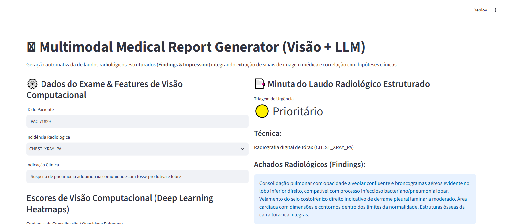

# 🩻 Multimodal Medical Report Generator (Visão + LLM)

[](https://www.python.org/downloads/)
[](#)
[](#)
[](#)
[](#)
[](#)

Pipeline de inteligência artificial multimodal que integra sinais visuais radiológicos (radiografia de tórax e tomografia) com correlação clínica para geração automatizada de minutas de laudos padronizados (**Findings** e **Impression**) com triagem de urgência (**STAT Alert**).

---

## 📸 Validação Visual de Execução (Playwright E2E)

### Minuta de Laudo Estruturado e Triagem de Urgência


---

## 🎯 Por que IA Multimodal em Radiologia?

A sobrecarga de trabalho dos radiologistas e o tempo até a liberação de laudos em serviços de urgência impactam diretamente o desfecho de pacientes graves (ex: pneumotórax, pneumonias lobares bacterianas e insuficiência cardíaca descompensada).

Este sistema realiza:
1. **Integração Visão-Linguagem**: Combina escores de convolução/deep learning extraídos do exame com a indicação médica prévia.
2. **Formatação Estruturada Padrão Colégio Americano de Radiologia (ACR)**: Separação formal entre Técnica, Achados (Findings) e Impressão Diagnóstica (Impression).
3. **Triagem de Urgência Automatizada**: Identificação instantânea de quadros com consolidação severa ou derrame pleural agudo classificando o exame como `CRITICAL_STAT`.

---

## 🏛️ Estrutura Arquitetural (CRISP-DM + SDD)

```
multimodal-medical-report-generator/
├── SPEC.md                           # Contratos Pydantic formais de entrada/saída
├── crisp_dm/
│   └── 01_business_understanding.md  # Fundamentação clínica e critérios de triagem
├── src/
│   ├── schemas.py                    # Schemas Pydantic validados
│   ├── multimodal_engine.py          # Motor de correlação multimodal e laudos
│   └── app.py                        # Interface do radiologista (Streamlit)
├── tests/
│   └── unit/
│       └── test_multimodal_engine.py # Testes de consistência diagnóstica com PyTest
├── docs/
│   └── screenshots/                  # Evidências Playwright E2E
├── Dockerfile                        # Imagem pronta para produção
└── requirements.txt                  # Dependências fixadas
```

---

## 🧪 Achados Mapeados e Códigos RadLex

| Achado Radiológico | Localização Anatômica | Código RadLex | Nível de Urgência Padrão |
| :--- | :--- | :--- | :--- |
| **Consolidação Pulmonar** | Lobo inferior direito | `RID4326` | `PRIORITY` / `CRITICAL_STAT` |
| **Derrame Pleural** | Seio costofrênico | `RID4896` | `PRIORITY` / `CRITICAL_STAT` |
| **Cardiomegalia** | Silhueta cardíaca | `RID3457` | `PRIORITY` |
| **Exame Normal** | Campos pulmonares | - | `ROUTINE` |

---

## 🚀 Como Executar Localmente

### 1. Clonar o repositório
```bash
git clone https://github.com/generozo-paulo/multimodal-medical-report-generator.git
cd multimodal-medical-report-generator
```

### 2. Instalar dependências
```bash
pip install -r requirements.txt
```

### 3. Rodar suíte de testes unitários
```bash
python -m pytest tests/unit/ -v
```

### 4. Executar Dashboard Radiológico
```bash
python -m streamlit run src/app.py
```
Acesse em: `http://localhost:8501`

---

## 🐳 Execução via Docker

```bash
docker build -t multimodal-medical-report-generator .
docker run -p 8501:8501 multimodal-medical-report-generator
```

---

## 👨‍💻 Autor

**Paulo Generozo**
- GitHub: [@generozo-paulo](https://github.com/generozo-paulo)
- Especialização: Visão Computacional, Multimodal AI & Health Informatics
